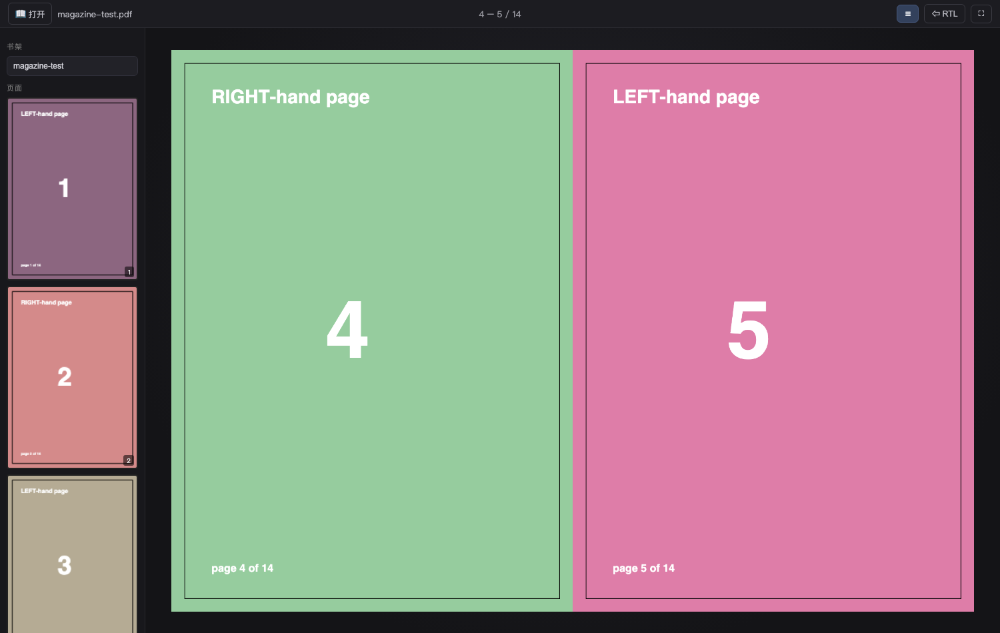
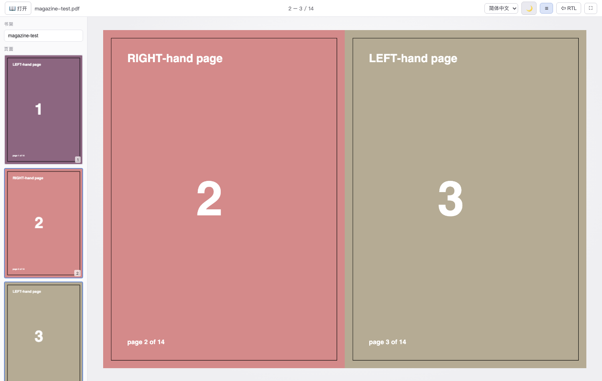

# MagReader · 杂志阅读器

像读书一样读 PDF 杂志和 EPUB 电子书：双页对开、卷页翻页动画、书脊阴影。纯本地离线运行，零运行时依赖。




## 用法

**方式 A（推荐，带书架）**

```sh
python3 serve.py          # 默认端口 8666
# 浏览器打开 http://localhost:8666
```

把 PDF / EPUB 放进 `books/` 目录，首页书架和左侧列表就会出现，点开即读。自带 `magazine-test.pdf` 测试页，clone 下来立刻可试。书架条目悬停可点 × 删除（会真删 books/ 里的文件，有确认框）。

**方式 B（零依赖）**

直接双击 `index.html`，把 PDF / EPUB 拖进窗口即可（没有书架列表，其余功能相同）。

## 功能

- 双页对开 + 真实卷页动画（拖拽页角 / 点击页面 / 滑动翻页）
- **EPUB 电子书**：浏览器内 JSZip 解包、按 OPF spine 排章、净化后用 CSS 多栏裁成固定书页——对开翻页、缩略图、进度记忆、批注、AI 提取全部通用；包内图片/CSS 走 blob URL，封面优先取包内 cover-image，没有就用书名生成文字封面
- 封面单页展示（LTR 模式）
- 书架首页：封面网格展示 books/ 与最近打开的书，顶栏 🏠 随时返回
- 书架条目支持拖拽排序（侧栏列表和首页封面卡片都可以拖，「最近打开」同样可拖），顺序本地保存
- 最近打开记忆：拖入/选中的文件存入 IndexedDB，下次直接点开
- 记住每本书的阅读进度与翻页方向（localStorage，按文件名+大小区分）
- 左侧缩略图栏，点击跳页
- RTL 模式：从右到左翻页（日漫/竖排杂志），动画和手势方向同步镜像
- 双击页面 → 高清放大浮层（滚轮缩放、拖拽平移）
- 亮色 / 暗色主题切换（☀️/🌙 按钮，默认跟随系统）
- 界面语言：简体中文 / 繁體中文 / English（默认跟随浏览器语言）
- 窗口窄时自动切单页模式

## 批注（划线 / 高亮 / 笔记）

- ▮ **高亮标记**：横向拖动刷出固定行高的荧光带，像荧光笔扫过一行字
- ～ **波浪下划线**：拖过一行文字，自动在字下生成规整波浪线（用 pdf.js 文本提取按字号自适应振幅，并吸附到基线下方）
- 📝 **笔记**：点一下放图钉，弹出编辑框写笔记；再点图钉可改可删
- 🧽 **擦除**：点击批注附近即可删除（按距离就近命中），空点不会误翻页
- 批注随书保存在浏览器 localStorage，翻页不丢
- 侧栏「批注」列表列出全部笔记，点击跳到对应页
- 快捷键 `1`/`2`/`3`/`4` 切换工具，`0` 或 `Esc` 退出工具

## AI 总结

顶栏 ✨ 打开 AI 总结：提取当前书籍文本（PDF 逐页提取 / EPUB 按章提取），调用 **OpenAI 兼容接口**生成要点摘要。
点弹窗右上角 ⚙ 配置 `Base URL`（默认 `https://api.openai.com/v1`）、`API Key`、`模型`，
任何兼容 `/chat/completions` 的服务都能用（OpenAI、DeepSeek、Ollama、one-api 等）。
**密钥只存在本机浏览器 localStorage**，不会上传、不进仓库。

## 快捷键

| 键 | 作用 |
|---|---|
| → / 空格 | 下一页（RTL 下为 ←） |
| ← | 上一页（RTL 下为 →） |
| 1 / 2 / 3 / 4 | 高亮 / 划线 / 笔记 / 擦除 |
| 0 / Esc | 退出工具 · 关闭浮层 |
| T | 缩略图栏开关 |
| R | LTR/RTL 切换 |
| F | 全屏 |
| Home / End | 首页 / 末页 |

## 文件结构

```
index.html      页面骨架
css/style.css   样式（CSS 变量主题）
js/app.js       全部逻辑
vendor/         pdf.js 3.11 + page-flip 2.0.7 + jszip 3.10（已本地化，无 CDN 依赖）
serve.py        可选本地服务器（书架 API）
books/          把杂志 PDF / EPUB 放这里
docs/           README 截图
```

## English

A local, dependency-free PDF magazine & EPUB book reader that feels like a real book: two-page spreads, realistic page-curl animation with spine shadow.

**Run it:** `python3 serve.py` then open http://localhost:8666 — drop PDFs/EPUBs into `books/` to see them on the shelf. Or just double-click `index.html` and drag a file in.

**Features:** two-page spread with curl animation · **EPUB support** (in-browser unzip, spine-ordered chapters sanitized into fixed book pages via CSS columns; embedded images/CSS resolved to blob URLs) · per-book reading progress & direction memory (localStorage) · thumbnail sidebar · RTL mode for manga/vertical-layout magazines (fully mirrored layout & gestures) · double-click zoom overlay · annotations: highlight blocks, wave underlines and pinned notes (persisted per book, jump-to-page list) · dark/light themes · UI in 简体中文 / 繁體中文 / English.

## 第三方依赖（已 vendored，均有宽松开源许可）

- [PDF.js](https://github.com/mozilla/pdf.js) 3.11 — Apache-2.0
- [page-flip (StPageFlip)](https://github.com/Nodlik/StPageFlip) 2.0.7 — MIT
- [JSZip](https://github.com/Stuk/jszip) 3.10 — MIT

## License

MIT
